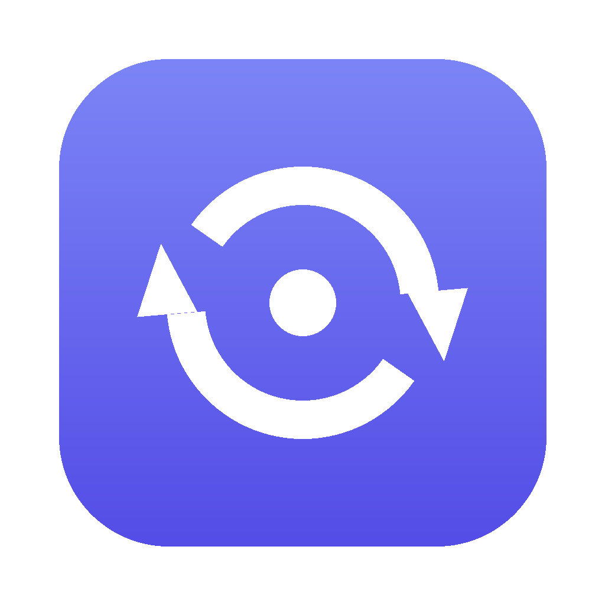
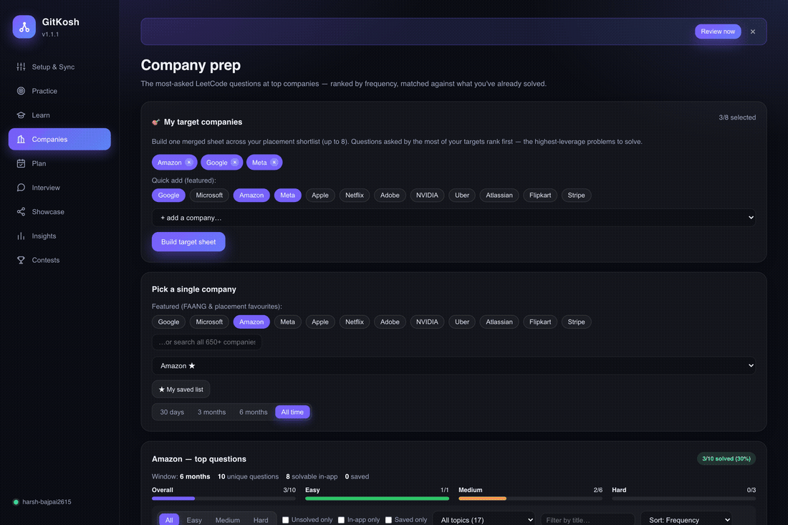
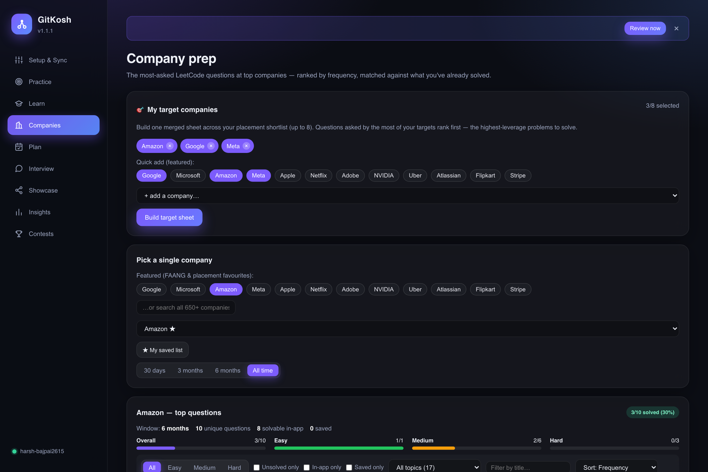
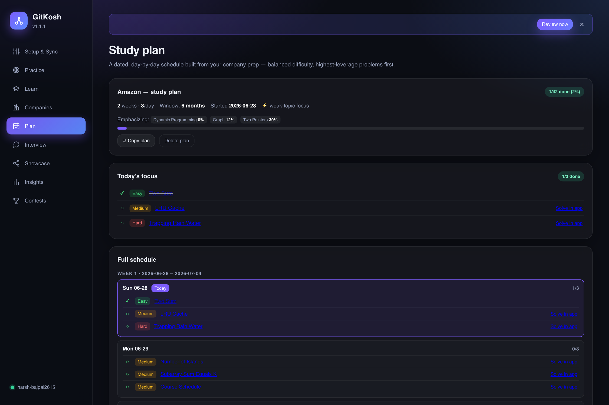
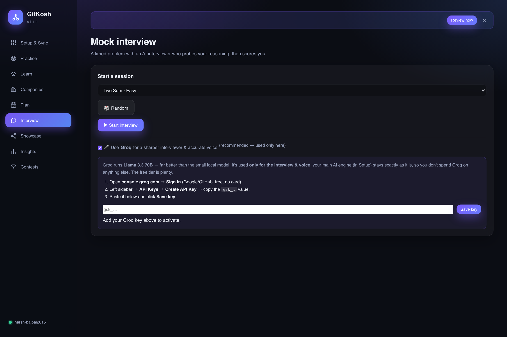
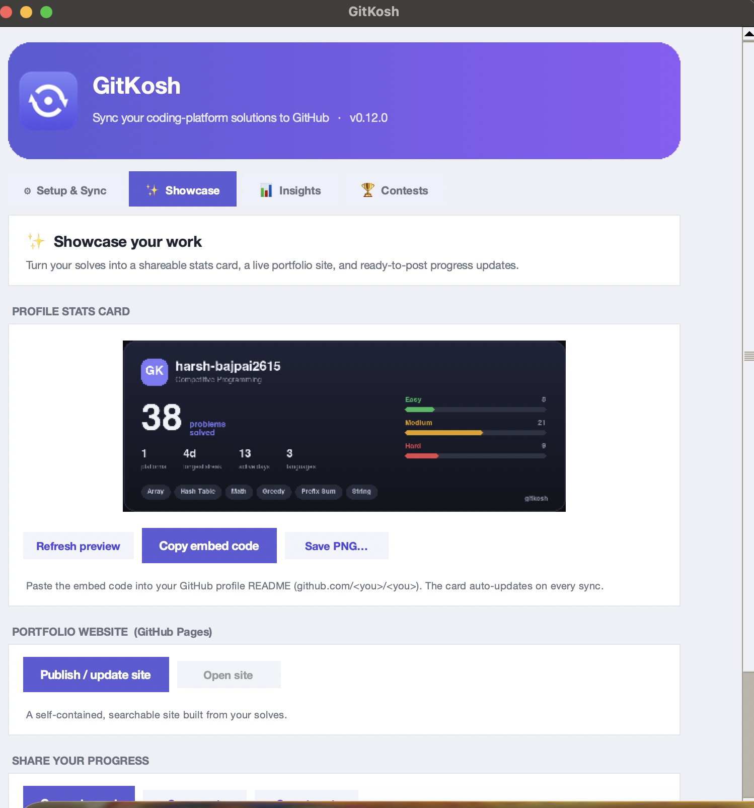
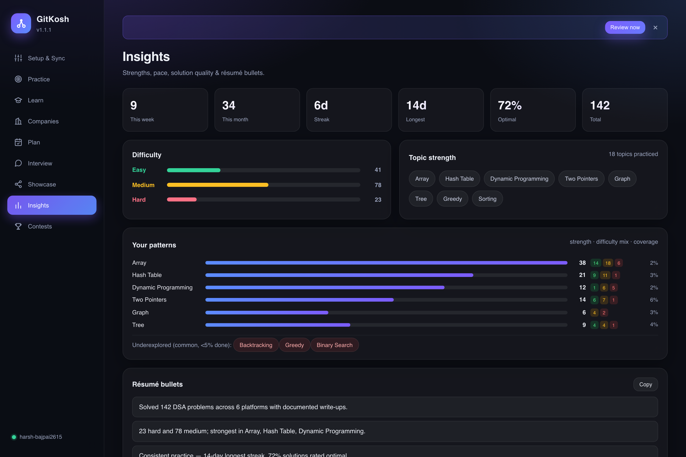
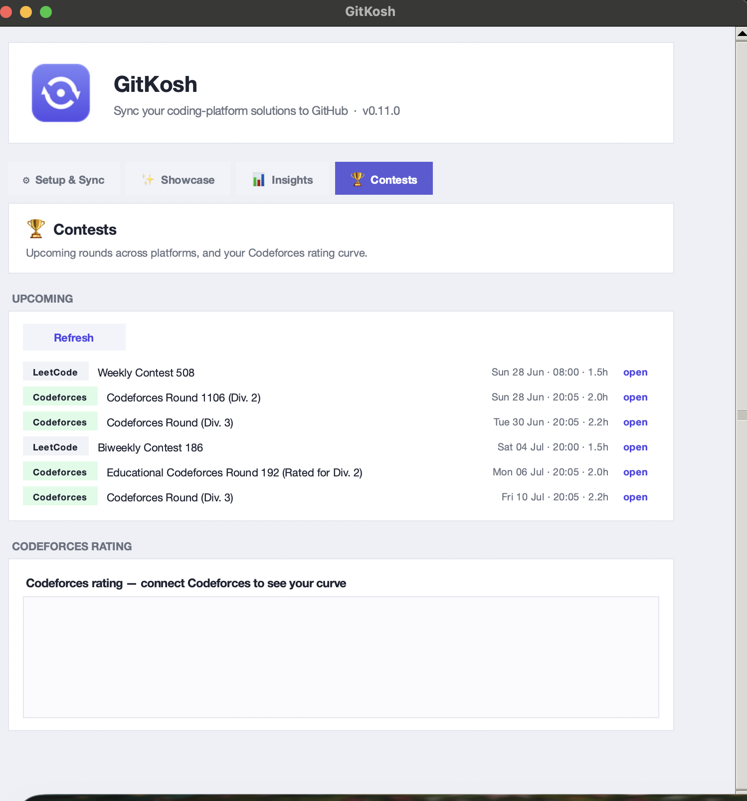

<div align="center">



# GitKosh

A DSA workspace for macOS. Practice the NeetCode 150 and Blind 75 in a built-in editor with progressive AI review, an offline DSA tutor and spaced-repetition revision. It also syncs your solves from LeetCode, Codeforces, CodeChef, NeetCode, AtCoder and GeeksforGeeks to GitHub on a daily schedule, each with an AI-written explanation, and can keep your contribution streak going


[Download for macOS](https://github.com/harsh-bajpai2615/gitkosh/releases/latest), [Features](#features), [How it works](#how-it-works), [Build from source](#build-from-source)

<br/>



</div>

## Overview

GitKosh is a macOS app with three parts that feed each other:

1. Learn and practice: a built-in code editor for the NeetCode 150 + Blind 75 (144 curated problems) with syntax highlighting, one-click Run / Run tests in Python, C++, Java and JavaScript, and a progressive, streaming AI review that goes from a gentle hint to a worked solution. It also has a mock interview mode (timed problem, AI interviewer, scorecard), an offline AI DSA tutor, a pattern library with practice-this-pattern drilldowns, an algorithm visualizer and spaced-repetition Quiz Me
2. Interview prep by company: the most-asked LeetCode questions for 657 companies (FAANG and placement favourites featured), matched against what you've already solved. Filter by difficulty, topic or unsolved, bookmark across companies, build a multi-company target sheet, and generate an auto study plan: a dated schedule that emphasizes your weak patterns and reminds you daily
3. Sync and showcase: turns your competitive-programming solves into a documented GitHub repository. GitKosh pulls every accepted submission, writes a per-problem README (summary, a numbered algorithm of your solution, complexity, key insight) and pushes it on a daily schedule, which also keeps your contribution graph green. It can also import your real past local work onto the graph with the dates it was actually written

GitKosh does not replace the platforms' own editors. You keep solving where you already do, and it archives and documents the work. Your passwords are never stored: login goes through the system's WebKit cookie store

## Features

### Company interview prep
- Most-asked questions for 657 companies. Pick a company (FAANG and the Indian-placement "dream" and "super-dream" tier are featured) and a recency window, and see its top LeetCode questions ranked by frequency, each marked as solved if you've already solved it and "in-app" if it's solvable in the built-in editor
- Filter, sort and search: difficulty, unsolved-only, in-app-only, saved-only, topic/pattern, title search and several sorts, with per-difficulty progress bars
- Personal saved list and bookmarks across companies, plus a Markdown checklist export
- Multi-company target sheet: shortlist up to 8 dream companies and get one merged, de-duplicated sheet ranked by overlap ("asked at: Amazon, Google, Meta"), so the highest-leverage problems come first
- Auto study plan: turn any company or target view into a dated N-week schedule with balanced daily difficulty and an optional weak-topic emphasis. A Plan tab tracks progress and a daily reminder nudges you

### Learn and practice
- Solve in-app in 4 languages, 144 problems: a built-in editor with syntax highlighting for the NeetCode 150 + Blind 75. Run / Run tests in Python, C++, Java or JavaScript (uses your local toolchains, with an install hint if one's missing). Your work is auto-saved per problem
- Progressive, streaming AI review: if you're stuck it escalates one step at a time (small hint, bigger hint, algorithm, pseudocode, worked solution), streamed token by token. Once you get it right, it reviews complexity, code quality and optimizations. Ollama runs free and offline
- Mock interview mode: a timed problem with an AI interviewer that probes your reasoning and edge cases, then a structured scorecard (overall hire signal, problem-solving, communication, complexity, code quality)
- AI DSA tutor, pattern library and visualizer: a streaming chat tutor, a browsable pattern library with practice-this-pattern drilldowns into matching in-app problems, and an animated sorting visualizer
- Launch review nudge: a startup banner when spaced-repetition reviews are due, with one click to start them

### Sync, archive and showcase
- Logins for LeetCode, Codeforces, CodeChef, NeetCode, AtCoder, GeeksforGeeks and GitHub are the whole sync setup. A guided 3-step flow makes the order obvious
- AI write-ups for every problem: problem summary, a numbered algorithm of your actual code, time/space complexity and a key insight, in Markdown
- Import your real past work: point GitKosh at a local project folder and it archives it to your repo, dated to when you actually wrote it (real git author dates, or file timestamps), so work you never pushed shows on your contribution graph
- Real-date commits: each solution is committed on the day you actually solved it, so your GitHub contribution graph reflects your real history and not one big dump dated today
- Dashboard and portfolio site: your repo's front page and a one-click GitHub Pages site show totals, streak, difficulty/language/platform/topic breakdowns and a searchable index of every problem
- Interview-prep exports: a "Browse by topic" (patterns) view in the dashboard, plus a `study/` folder with Anki cards, a Notion CSV and a spaced-repetition "revise these" list, all generated from your solves
- Shareable stats card: an auto-updating image (solved count, streak, difficulty split, top topics) to embed in your GitHub profile README, with a one-click "Copy embed code"
- Progress posts: dev.to, LinkedIn and X drafts generated from your recent solves
- AI solution coach: every write-up assesses whether your solution is optimal and suggests a better approach (with complexity) when it isn't
- Insights dashboard: in-app analytics with a per-topic strength breakdown (difficulty-weighted, with coverage and an "underexplored patterns" callout), difficulty mastery, pace and streak, "% optimal", a revisit list and copy-able résumé bullets (also saved as `insights.md`)
- Quiz me: spaced-repetition recall. GitKosh shows a past problem and you recall the approach before revealing it
- Contest tracker: upcoming Codeforces and LeetCode rounds, plus your Codeforces rating curve
- Browser extension (beta): captures accepted LeetCode submissions in real time and pushes them to GitHub, so it works on Windows and Linux too
- Reset and re-backfill: one click rebuilds the whole repo as a clean, backdated history that mirrors your real solving timeline
- Bring-your-own AI, including free and local: Google Gemini, Groq, or one-click local Ollama (no key, no limits, fully private)
- Daily auto-sync: a background scheduler runs even when the app is closed
- Streak keeper: on days with no new solves it makes a small dated commit so your GitHub streak stays alive
- In-app auto-update: new versions install with one click
- Nothing to install on your Mac: no `git`, no terminal, no Python. It talks to GitHub over the API and ships its own runtime
- Live progress: a progress bar showing Fetching, Writing READMEs i/N, Pushing, Done

## Company prep tab

<div align="center"></div>

Questions per company, ranked by frequency and matched against your solves, with the filters, bookmarks and multi-company target sheet described above

## Study plan tab

<div align="center"></div>

A dated, day-by-day schedule with balanced daily difficulty and an optional weak-topic emphasis. A "Today's focus" card shows what to solve, progress tracks against your real solves, and a daily reminder keeps you on pace

## Mock interview tab (voice)

<div align="center"></div>

A timed problem with an AI interviewer that speaks its questions aloud and lets you answer by voice (auto-listen between turns), then grades you with a structured scorecard. You can switch on Groq just for the interview and voice, which gives a stronger interviewer model (Llama 3.3 70B) without changing your main free/local AI engine

## Learn & Solve tab

<div align="center"></div>

Practice the NeetCode 150 + Blind 75 without leaving the app: a syntax-highlighted editor that runs Python, C++, Java and JavaScript, Run / Run tests, a streaming AI tutor, a pattern library with practice drilldowns, and an algorithm visualizer, all on one page

<div align="center"></div>

Click **AI Review** and GitKosh coaches you progressively: a small hint first, then a bigger one, then the algorithm, then pseudocode, and the full worked solution only if you still need it. Once you solve it correctly it switches to reviewing your complexity, code quality and how to optimize further

## Showcase tab

<div align="center"></div>

A live stats card, a one-click portfolio website and shareable progress posts, all generated from your own solves

## Insights tab

<div align="center"></div>

Topic strengths, difficulty mastery, solving pace, AI solution-quality coaching, résumé bullets and a built-in spaced-repetition quiz

## Contests tab

<div align="center"></div>

Upcoming Codeforces and LeetCode rounds with one-click open, plus your Codeforces rating curve

## Browser extension (beta)

The macOS app is the full experience. The [`extension/`](extension) folder is a lightweight
Chrome/Edge/Brave companion that pushes your accepted LeetCode submissions to GitHub the
instant they pass, so it also runs on Windows and Linux. Load it unpacked, paste a GitHub
token and repo, and solve. See [`extension/README.md`](extension/README.md)

## Install

1. Download the latest `gitkosh.dmg` from [Releases](https://github.com/harsh-bajpai2615/gitkosh/releases/latest)
2. Open it and drag GitKosh into Applications
3. First launch. GitKosh is free and open-source but not Apple-notarized (that needs a paid Apple Developer account), so macOS shows "Apple could not verify GitKosh is free of malware". This is expected for any indie app. Use whichever unlock works for your macOS:

   macOS 15 Sequoia and newer (the dialog only offers Done and Move to Bin):
   - Click **Done**, then open System Settings, then Privacy & Security, scroll down to "GitKosh was blocked..." and click **Open Anyway**, then confirm with Touch ID or your password. It opens normally from then on

   macOS 14 and earlier: right-click the app, choose **Open**, then click **Open** again. This is needed once

   One-line alternative (any version), which clears the download quarantine flag so the app just opens:
   ```bash
   xattr -dr com.apple.quarantine /Applications/GitKosh.app
   ```

   After the first unlock, GitKosh opens with a double-click and updates itself in place

## Usage

1. Connect GitHub: one-tap "Login with GitHub" (OAuth device flow)
2. Connect your coding sites: log in and your handles are detected automatically
3. Choose write-ups: paste a free Gemini or Groq key, or set up Ollama in one click (free, local)
4. Sync, or switch on daily auto-sync and leave it

Your solutions land in your repo like this:

```
leetcode/0001-two-sum/
├── solution.py
└── README.md      # problem, algorithm, complexity, key insight
```

## Write-up providers

| Provider | Cost | Setup | Daily limit |
|---|---|---|---|
| Ollama (local) | Free | One-click install, in-app | None |
| Groq | Free tier | Paste an API key | High |
| Gemini | Free tier | Paste an API key | Low |
| None | Free | Nothing | No AI, statement and code only |

## Automation and streak keeping

Turn on **Sync automatically every day** and GitKosh installs a macOS LaunchAgent that runs a sync daily, even with the app closed. With **Keep my GitHub streak alive** on, days with no new solves still get a small dated commit to `activity/streak.md`, so your contribution graph stays green

## How it works

- Login: a native WebKit window captures your session cookie (no passwords stored), and GitHub uses OAuth Device Flow (no client secret shipped)
- Fetch: one extractor per platform (LeetCode GraphQL, Codeforces API + page scrape, CodeChef scrape, NeetCode via LeetCode)
- Document: a pluggable LLM layer writes each README from your code and the official statement
- Push: the GitHub REST API (Git Data API) commits everything, so no `git` or `gh` is needed on your machine
- Schedule: a LaunchAgent runs the same headless sync on a daily cron
- Update: the app checks GitHub Releases on launch and replaces itself

```
LeetCode ─┐
Codeforces┤   WebKit login (cookies)         Gemini / Groq / Ollama (write-ups)
CodeChef ─┼─> extractors ─> submissions ─>  README generator ─> GitHub API ─> your repo
NeetCode ─┘   GitHub Device Flow (token)     scheduler (daily) + streak keeper
```

## The app

GitKosh is a desktop app built on pywebview (a native WebKit window), in `webui/` and
`app/webmain.py`. The UI has a glassmorphism sidebar, gradient buttons, animated stat tiles,
difficulty bars and a live rating chart, all driven by the same Python backend over a
JS/Python bridge, with no logic duplicated

<div align="center"></div>

Run it from source:

```bash
.venv-app/bin/python -m pip install pywebview
.venv-app/bin/python -m app.webmain
```

The Practice tab:

- Spaced-repetition Quiz Me (SM-2): rate Again / Hard / Good / Easy, only due cards resurface, and review streaks are tracked
- Three quiz modes: Recall, Type (AI-graded recall) and Pattern (multiple-choice topic guess)
- Problem of the Day: what to review or solve next, plus your weakest topics
- Roadmaps: live Blind 75 and NeetCode 150 progress from your solves
- The scheduled daily run also sends a macOS reminder when reviews are due

The Learn tab combines learning and solving, see [Learn & Solve](#learn--solve-tab) above.
It has the in-app editor for all 144 problems, progressive AI review, the DSA tutor, the
pattern library and the algorithm visualizer

`webui/index.html` also opens directly in a browser with sample data

## Build from source

Requires macOS and a [python.org](https://www.python.org/downloads/macos/) framework Python (3.13 recommended)

```bash
git clone https://github.com/harsh-bajpai2615/gitkosh
cd gitkosh
./build_app.sh          # builds dist/gitkosh.app and dist/gitkosh.dmg
```

Cut a release that installed copies will auto-update to:

```bash
# 1) bump VERSION (semver) in app/constants.py
# 2) add a section for it to CHANGELOG.md  (release.sh pulls it into the notes)
# 3) publish:
./release.sh
```

`release.sh` enforces the bump: it validates semver, refuses to re-ship an
already-published version (so installed copies always see a strictly higher
version), warns on an uncommitted tree and uses your CHANGELOG entry as the
release notes. Set `RELEASE_FORCE=1` only to re-upload assets for the same tag

## Project structure

```
app/            macOS app: UI bridge, WebKit login, sync core, scheduler, updater,
                runner (multi-language), companies/studyplan/backfill, insights, site
app/data/       bundled company catalog (companies.json) + LeetCode topic map
gitkosh/        platform extractors, README generator (+ streaming), GitHub helpers
extension/      cross-platform browser extension (real-time LeetCode to GitHub sync)
webui/          pywebview front-end (index.html / app.js / style.css)
setup.py        py2app bundle config           build_app.sh   build .app + .dmg
release.sh      build + publish a release       CHANGELOG.md   release notes source
```

## Notes and limitations

- macOS only (uses native WebKit and LaunchAgents)
- Not notarized yet, so first launch needs right-click then Open. Updates install in place after that
- CodeChef is best-effort (Cloudflare, no public API)
- AtCoder pulls AC submissions via the kenkoooo API and scrapes each submission's source
- GeeksforGeeks is index-only (titles, links and difficulty). GFG exposes no submitted source code, so there are no `solution.*` files for it
- Free Gemini has a low daily cap, so use Ollama (local) or Groq for large backfills
- Your data (logins, settings, history) lives in `~/Library/Application Support/GitKosh/` and survives updates

## License

[MIT](LICENSE) © Harsh Bajpai
